# はじめに

Autodesk Forma（旧 Autodesk Construction Cloud / ACC）の API を使って自前のシステムを作ろうとしたとき、最初の関門はコードではなく**環境構築**でした。

- APS アプリを作ったのに、API を叩いてもハブが **0件** で返ってくる
- 手順書にあるはずの「カスタム統合」という画面が**そもそも表示されない**ことがある
- 無料のはずの Free プランで**クレジットカード登録**を求められる

この記事は、2026年11月に新規アカウントから実際に構築した記録をもとに、「Forma の各種 API から実応答が返る状態」になるまでの手順と、つまずきポイント・その原因・回避策をまとめたものです。API の使い方そのもの（エンドポイント解説）ではなく、**叩けるようになるまで**が範囲です。

検証に使ったサンプルコードは別リポジトリで公開しています。

- サンプル: https://github.com/tkhashi/Autodesk.Sandbox

> スクリーンショットはすべて今回の検証環境で実際に撮影したものです。メールアドレス・電話番号・Client ID・注文番号などはマスキングしています。

## 全体像：「ハブ」と「チーム」が3種類ある

つまずきの半分は、この3つを混同することから起きます。

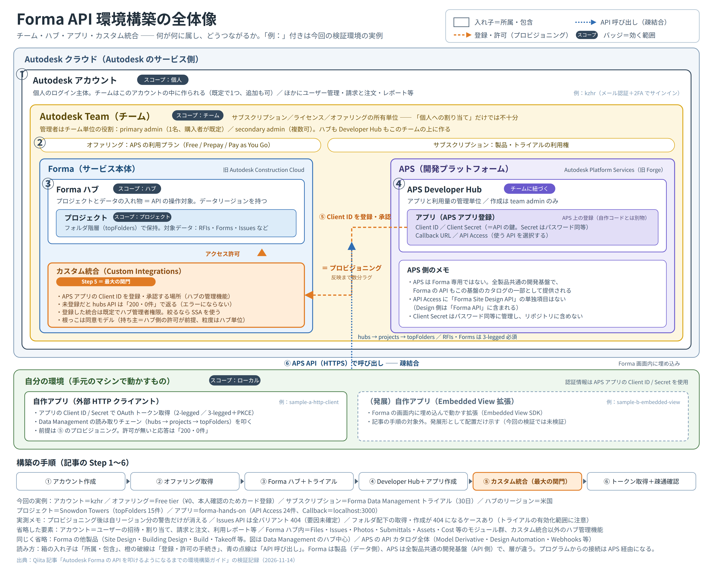

| 名前 | 何か | どこで作るか |
|---|---|---|
| Autodesk Team（チーム） | サブスクリプションとライセンスの所有単位 | Autodesk Account |
| Forma ハブ（旧ACCハブ） | プロジェクトとデータの入れ物。API の操作対象 | Forma / ACC |
| APS Developer Hub | APS アプリと利用量の管理単位。チームに紐づく | APS ポータル / Autodesk Account |

そして API を叩くには、次の **2点セット** が揃っている必要があります。

1. APS アプリの **Client ID / Client Secret**
2. 操作先の **Forma ハブ・プロジェクト**（＋そのハブへのアプリの許可＝カスタム統合）

## 用語メモ（全部 Autodesk の公式用語です）

この記事に出てくる分かりにくい言葉は、どれも Autodesk の製品・ドキュメント上の正式な用語です。先に意味だけ押さえてください。

| 用語 | 意味 |
|---|---|
| オファリング（offering） | APS の利用プラン（提供形態）のこと。Free / Prepay（前払い）/ Pay as You Go（従量）の3種があり、チーム単位で取得する |
| カスタム統合（Custom Integrations） | Forma ハブの管理画面にある機能の名前。APS アプリの Client ID をここに登録すると、そのアプリがそのハブのデータにアクセスできるようになる |
| プロビジョニング（provisioning） | 上記の「アプリにアクセス権を与える」手続き自体を指す APS ドキュメントの言葉（"Provision access"）。アプリを作るだけでは権限は付かず、この手続きが別途必要 |

## 手順の地図

```
1. Autodesk アカウント作成
2. APS オファリング取得（Free tier）← カード登録あり（¥0）
3. Forma 側のハブとトライアル（Data Management 等）
4. APS Developer Hub とアプリ作成
5. カスタム統合（プロビジョニング）← 最大の関門
6. トークン取得と疎通確認（hubs → projects → topFolders）
```

---

## Step 1: Autodesk アカウント作成

公式サイトから新規アカウントを作成します。流れは「メールアドレス → 本人確認（hCaptcha）→ メールコード（6桁）→ 氏名・パスワード」でした。

作成の入口になる登録フォームは、このような画面です。

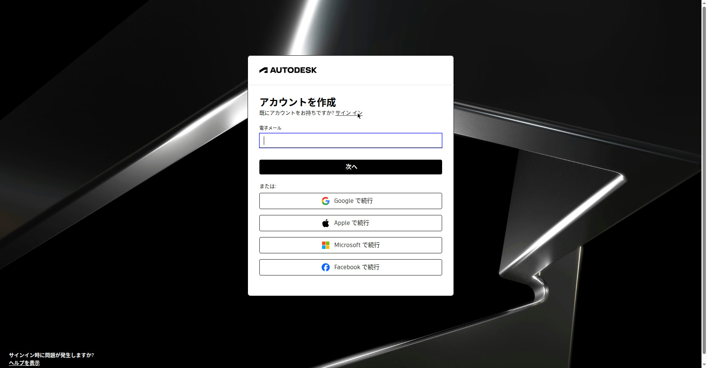

## Step 2: APS オファリングの取得（Free tier）

APS（Autodesk Platform Services）の現在のビジネスモデルでは、**チームに APS のオファリング（＝利用プラン。無料の Free tier 含む）を紐づけ、そのチームの中に Developer Hub を作る**ことが必須になっています。[^1]

### ⚠️ つまずきポイント：無料でもクレジットカード登録が必要

Free tier でも、**本人確認のために支払い方法の登録が必須**です。公式ページにも「A payment method is required to verify your identity. You won't be charged unless you choose to upgrade to a paid tier.」と明記されています。[^2]

- 実際に Free を注文したときの合計は **¥0** でした（本人確認用にカードを登録）
- 「無料のはず」という理由で身構える必要はありませんが、**実際に課金が発生する／有料プランが開始する場合は別**です。金額表示は必ず確認してください

注文が完了すると、Autodesk Account の課金サマリーに APS Free が「1件のサブスクリプションまたは契約」として計上されます。

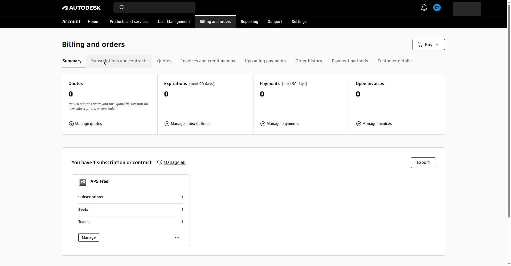

実際の注文履歴でも、APS Free の合計は ¥0 で、課金されていないことが確認できます。

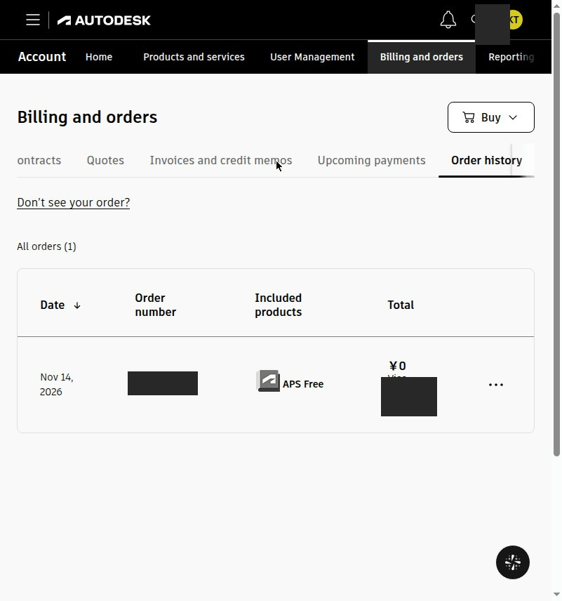

[^1]: [APS Business Model Evolution | Autodesk Platform Services](https://aps.autodesk.com/blog/aps-business-model-evolution)
[^2]: [Autodesk Platform Services | Autodesk](https://www.autodesk.com/sg/products/autodesk-platform-services/overview)

## Step 3: Forma 側のハブとトライアル

API の操作対象になる Forma ハブを用意します。今回は Forma Data Management の30日トライアルを開始し、サンプルプロジェクト「Snowdon Towers」付きのハブを作成しました。

開始したトライアルは、Autodesk Account の Trials 一覧でこのように有効表示されます（残り30日）。

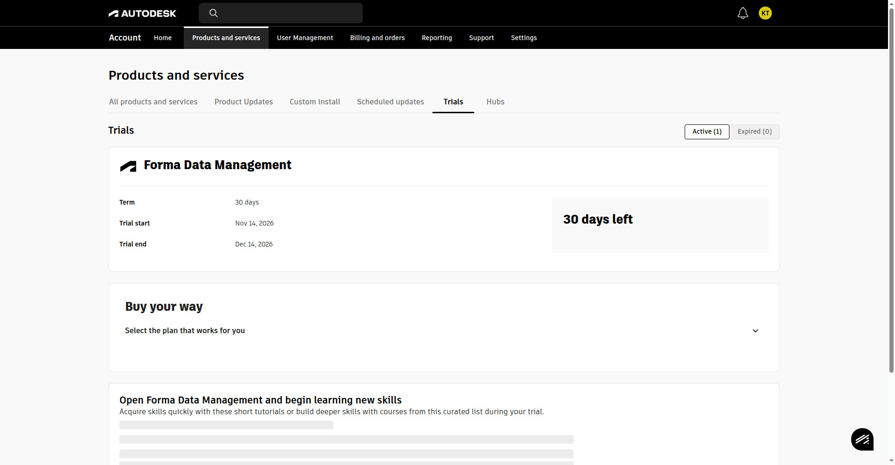

### ⚠️ つまずきポイント

- **ハブはチームに属する。** サブスクリプションとハブはチーム単位の資産です（この性質が Step 5 の「カスタム統合が出ない」問題の原因になります）。
- **ハブを作成できるのは、チームの primary / secondary admin（有効なサブスクリプションがあること）**です。自分にその権限がない場合は管理者への依頼が必要です。[^3]
- **データリージョンは選べないことがある。** 今回のトライアルでは開始時に選択肢が提示されず、ハブのリージョンは米国になりました。リージョンが要件にある場合は先に確認してください。

作成されたハブは、ハブ一覧ではこのように表示されます。地域（データリージョン）は米国になっています。

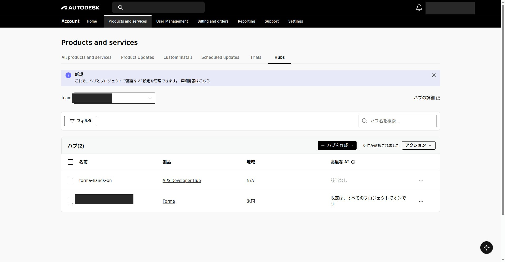

[^3]: [Collaboration | Autodesk Support](https://www.autodesk.com/support/account/admin/users/collaboration)

## Step 4: APS Developer Hub とアプリ作成

APS ポータルで Developer Hub を作成し、その中にアプリを作成します。

Developer Hub の作成は、チームと名前を指定するセットアップ画面から始まります。

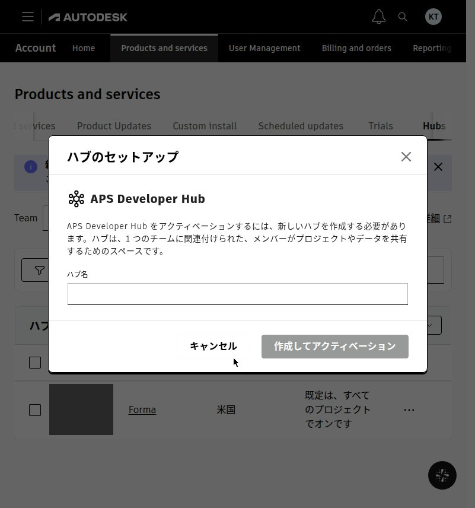

有効化が完了すると、Developer Hub がこのように使える状態になります。

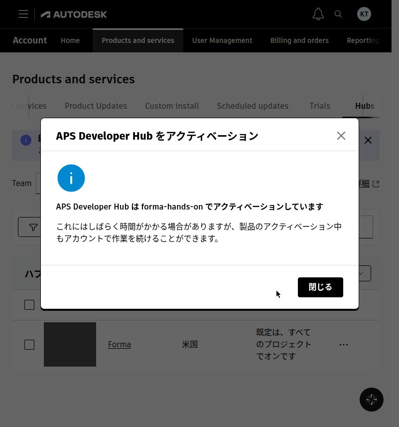

- Developer Hub はチームに紐づくもので、作成できるのは **team admin のみ**です[^4]
- アプリは Traditional Web App（Authorization Code ＋ Client Credentials）を選択
- コールバック URL は後段のログイン実装と**完全一致**させます（今回は `http://localhost:3000/callback`）

作成したアプリの設定画面では、Client ID と Client Secret が発行されます（Secret は伏せ字表示で、この2つが API の鍵になります）。

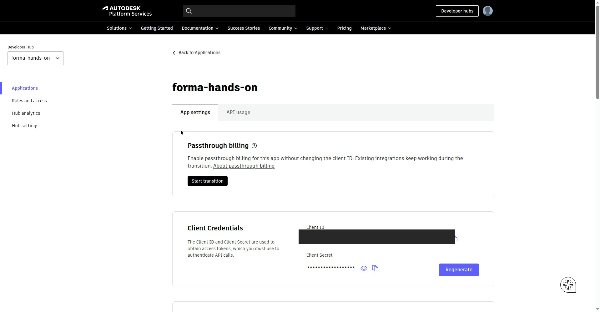

コールバック URL は、アプリ設定のこの欄に入力します。

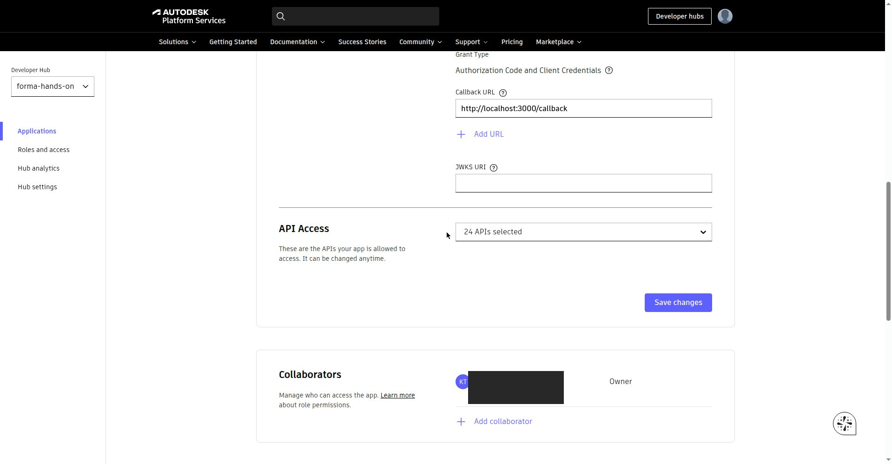

### ⚠️ つまずきポイント

- **API Access の選択リストに「Forma Site Design API」という単独項目はありません。** Design 側の API は「Forma API」に含まれます。リストで探して見つからなくても故障ではありません。
- **コールバック URL が空欄だと保存エラー**になります。先に入力してから保存してください。
- Client Secret の取り扱いは「パスワードと同等」です。リポジトリには絶対に含めないでください。

API Access の選択リストはこのような項目構成になっていて、「Forma Site Design API」の単独項目は見当たりません。

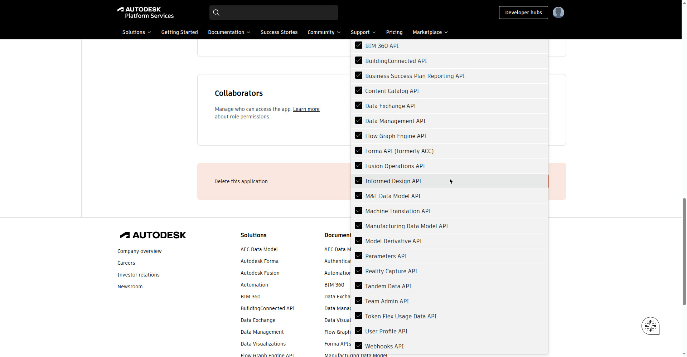

[^4]: [Developer hubs user guide | Autodesk Platform Services](https://aps.autodesk.com/blog/developer-hubs-user-guide)

## Step 5: カスタム統合（プロビジョニング）← 最大の関門

**APS アプリを作っただけでは、Forma のデータは見えません。**

アプリの Client ID を、対象の Forma ハブ側の管理機能「カスタム統合（Custom Integrations）」に登録・承認する作業が必要です。APS のドキュメントではこの手続きを指して provisioning（プロビジョニング）という言葉が使われます。公式チュートリアルでも、プロビジョニングには対象ハブへの **admin アクセス** が必要とされています。[^5]

手順は、Forma ハブの管理画面（Hub Admin）の「カスタム統合」を開き、Client ID を追加するだけです（現行 UI では左ナビの独立項目。旧 ACC UI では `Settings → Custom Integrations`）。[^6]

追加は、このダイアログに Client ID と統合の名前を入力して行います。

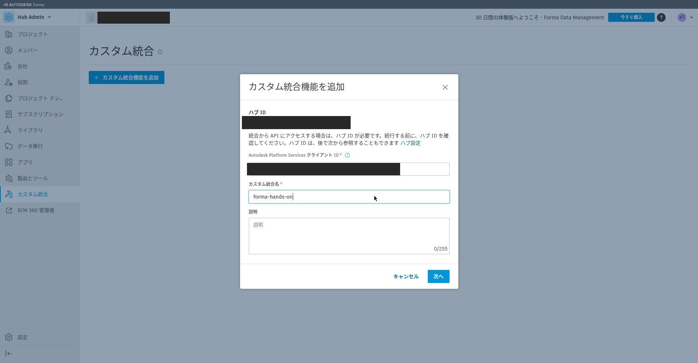

登録が完了すると、カスタム統合の一覧にアプリの行がこのように追加されます。

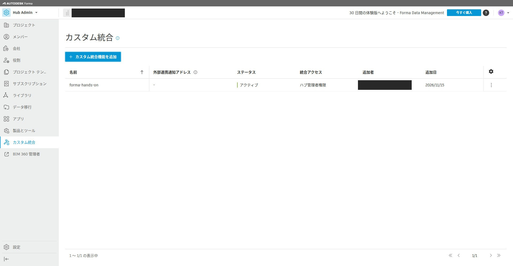

### なぜこの仕組みがあるのか（同意モデルと許可の粒度）

プロビジョニングの根っこは、**データの持ち主はハブ側（顧客・チーム）である**という同意モデルです。APS アプリはプラットフォーム上に存在するだけでは、誰のハブのデータにもアクセスできません。ハブごとに管理者が Client ID を登録して初めて、そのハブの範囲で API が効くようになります。

ただし、許可の粒度には注意が必要です。

- **既定（SSA なし）**：統合はハブ管理者として動作し、**そのハブ配下の全プロジェクト**が対象になります。「プロジェクト単位で許可した」状態ではありません[^6]
- **SSA を紐づけた場合**：その SSA がプロジェクトに招待された範囲だけが対象になり、プロジェクト単位で権限を制御できます。アクセスレベルは Full Hub Access / Full Project Access / Project Access の3段階で定義されています[^6][^7]

つまり「許可したハブのプロジェクトに限定される」という理解は方向としては正しいものの、既定の限定単位はプロジェクトではなく**ハブ**です。

### ⚠️ つまずきポイント①：200 なのに 0 件

プロビジョニング前は、Data Management API の `GET /project/v1/hubs` が **HTTP 200 で、しかし中身は0件** で返ります。エラーにならないので「プロジェクトが無いのか？」と誤解しがちです。

見分け方は「**data が0件で、`meta.warnings` に全リージョン分の `BIM360DM 403 "You don't have permission to access this API"` が入っている**」ことです。なお warnings 自体はプロビジョニング後も残りますが、**自分のハブがあるリージョンの警告だけが消えます**（この記事の検証環境では、登録前は US を含む全リージョン分 → 登録後は US の警告が消えてハブが1件返る、まで実応答で確認しました）。カスタム統合を登録すると、**数分の反映ラグ**のあとハブが見えるようになります。

登録前後の実応答を比べると、hubs が 0件から1件に変わっていることが分かります。

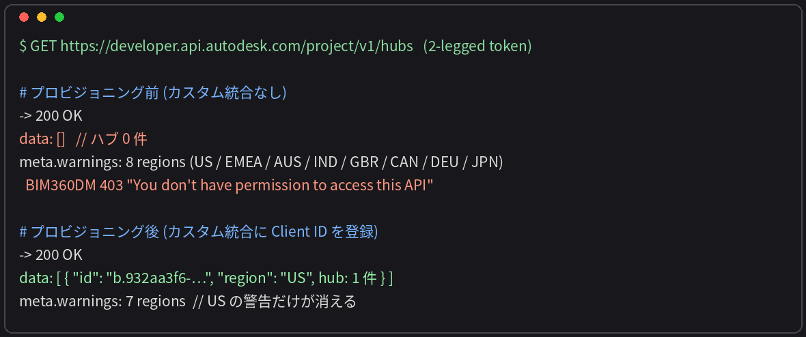

### ⚠️ つまずきポイント②：「カスタム統合」の画面自体が出ない（企業アカウント）

ライセンスを割り当ててもらっても、カスタム統合の画面自体が表示されないケースがあります。原因は **ライセンス／サブスクリプションが「チーム」に紐づいている**ことです。

- ライセンスのあるチーム上に作ったハブでのみ、カスタム統合が使える
- 個人で作った別チームのハブでは「サブスクリプションに有効なものがない」と出て、カスタム統合も出ない
- **ライセンスを「自分」に割り当ててもらうだけでは不十分**で、「ハブがそのチーム上にあるか」が条件

企業アカウントで開発する場合は、管理者に次の3点を依頼するのが近道です。

1. APS Developer Hub を作って招待してもらう（または使ってよいハブに追加してもらう）
2. ライセンスを割り当ててもらう
3. カスタム統合が使えるチーム紐づきのハブを作ってもらい、そのハブの管理者権限を付けてもらう

### ⚠️ つまずきポイント③：統合は既定で「ハブ管理者」権限

カスタム統合を追加するとき、**統合がハブ管理者権限で動作する**旨の警告ダイアログが出ます。これは仕様です。権限を絞りたい場合は **Secure Service Accounts (SSA)** を使う構成が用意されています（SSA が無い統合はハブ管理者として動作し、SSA を紐づければプロジェクト単位で権限を制御できます）。[^7][^8]

追加の際には、統合がハブ管理者権限で動作する旨の警告ダイアログがこのように表示されます。

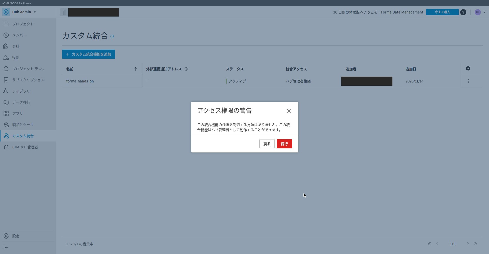

[^5]: [APS Getting Started Tutorials](https://get-started.aps.autodesk.com/)
[^6]: [Custom Integrations | Autodesk Forma Help](https://help.autodesk.com/cloudhelp/ENU/Docs-Admin/files/hub-administration/Custom_Integrations.html)
[^7]: [UPDATE: Secure Service Accounts (SSA) goes GA | Autodesk Platform Services](https://aps.autodesk.com/blog/update-secure-service-accounts-ssa-goes-ga)
[^8]: [Custom Integrations | Autodesk Forma Help](https://help.autodesk.com/cloudhelp/ENU/Docs-Admin/files/hub-administration/Custom_Integrations.html)

## Step 6: トークン取得と疎通確認

最後に、実際に API が応答するかを確認します。確認の順番は Data Management API の読み取りチェーンです。

```
GET /project/v1/hubs
GET /project/v1/hubs/{hubId}/projects
GET /project/v1/hubs/{hubId}/projects/{projectId}/topFolders
```

3つとも 200 で実データが返れば、環境構築は完了です（サンプルリポジトリの `sample-a-http-client` で `npm run acc` がこの確認です）。

### ⚠️ つまずきポイント

- **2-legged（Client Credentials）で叩けるのは一部だけ。** RFIs や Forms のようなドメイン API はユーザー文脈が必須で、2-legged では RFIs が 403（`missing userid in x-ads-token-data header`）、Forms が 401 になります。**3-legged（Authorization Code + PKCE）** を用意してください。
- **ドメイン API のプロジェクト ID は `b.` 接頭辞なし**です。Data Management で得た ID をそのまま使うと合わないことがあります。
- フォルダの中身の取得やフォルダ作成が 404 になるケースがありました（topFolders の一覧は返るのに、その先が 404）。トライアルハブでは一部機能が有効化されていない可能性があります。「一覧が返る＝全部使える」ではありません。

## つまずきポイント総覧

| # | 症状 | 原因 | 対処 |
|---|---|---|---|
| 1 | 無料の Free でカード登録を求められる | 本人確認のため（仕様） | 登録してよい。ただし金額表示は要確認（¥0） |
| 2 | ハブが作れない | 作成はチームの primary/secondary admin のみ | 管理者に依頼 |
| 3 | hubs が 200 なのに 0 件 | プロビジョニング（権限付与の手続き）未了 | カスタム統合に Client ID を登録し、数分待つ |
| 4 | カスタム統合の画面が出ない | ハブがライセンスのあるチーム上に無い | そのチーム上にハブを作ってもらう |
| 5 | ドメイン API が 403 / 401 | 2-legged で叩いている | 3-legged トークンを使う |
| 6 | プロジェクト ID が合わない | `b.` 接頭辞の有無 | ドメイン API では接頭辞なし |
| 7 | API 一覧に Site Design API が無い | 単独項目は存在しない | 「Forma API」に含まれる |
| 8 | コールバック保存でエラー | URL 空欄 | 先に入力してから保存 |

## おわりに

Forma の API 開発は、コードを書き始める前の「チーム・ハブ・統合」の3層を揃えるところが本体でした。特にプロビジョニング（カスタム統合）は、未了でもエラーにならず 0 件で返るため、知らないと半日溶けます。この記事が同じ場所で詰まる人の助けになれば幸いです。

次回は、この環境の上で実際に API を叩くサンプル（読み取り→書き込み）の話を書く予定です。

## 参考リンク

- [APS Business Model Evolution](https://aps.autodesk.com/blog/aps-business-model-evolution)
- [Developer hubs user guide](https://aps.autodesk.com/blog/developer-hubs-user-guide)
- [APS Getting Started Tutorials](https://get-started.aps.autodesk.com/)
- [Custom Integrations | Forma Help](https://help.autodesk.com/cloudhelp/ENU/Docs-Admin/files/hub-administration/Custom_Integrations.html)
- [Secure Service Accounts (SSA) goes GA](https://aps.autodesk.com/blog/update-secure-service-accounts-ssa-goes-ga)
- [Collaboration（管理者とハブ）| Autodesk Support](https://www.autodesk.com/support/account/admin/users/collaboration)
- サンプルコード: https://github.com/tkhashi/Autodesk.Sandbox
